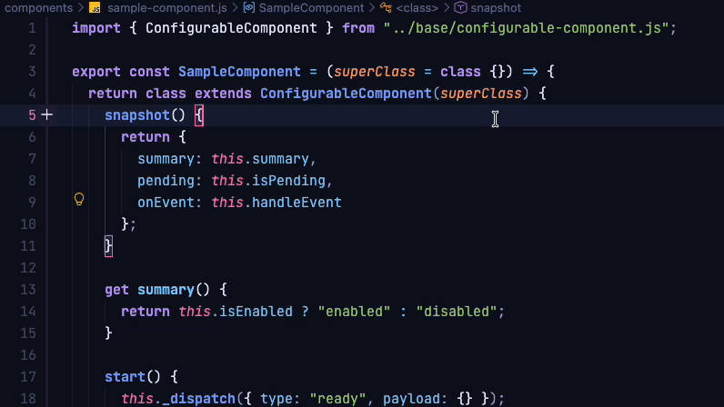
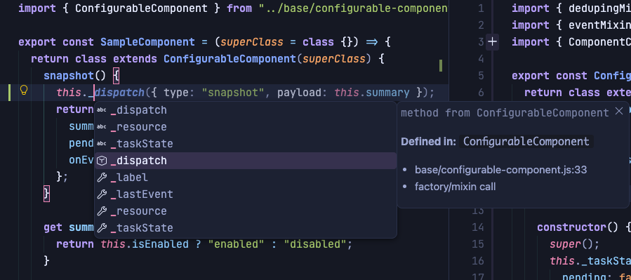

# InheritSense

Trace JavaScript class member origins across class factories and mixins in VS Code.

When a class member comes from a factory or a chain of mixins, its declaration can be
hard to find. InheritSense follows supported inheritance patterns to show which
class, factory, or injector supplies the member and where it is defined.

## Screenshots




## Features

- **Hover:** inspect inherited member origins, owner names, file locations, and
  available JSDoc.
- **Go to Definition:** navigate to inherited methods, getters, setters, and
  fields, including members supplied by supported factories and mixins, using
  VS Code's native Go to Definition actions and keyboard shortcuts.
- **Completion:** discover inherited members when typing `this.`, with their
  owners and locations in suggestion documentation.
- **Trace Selected Symbol:** choose an origin from a list and jump to its source.
- **Resolution:** follow local class ancestors, nested factory/mixin composition,
  and supported import aliases and reexports.

## Requirements

- VS Code 1.95.0 or later within the supported 1.x range.
- JavaScript files saved on disk with a `.js`, `.mjs`, or `.cjs` extension and the
  editor language set to JavaScript.

## Installation

### From the Marketplace

Open the Extensions view in VS Code, search for **InheritSense** by **kuscamara**,
then select **Install**. You can also open its
[Marketplace page](https://marketplace.visualstudio.com/items?itemName=kuscamara.inheritsense)
or install it with the VS Code command-line tool:

```sh
code --install-extension kuscamara.inheritsense
```

### From a VSIX

Clone the repository and build a `.vsix` package locally.
Then choose **Install from VSIX...** in the VS Code Extensions view and select
that file.

## Usage

Open a JavaScript file and place the cursor on a member reference inside a class.

- Hover over an inherited member to inspect its origin.
- Use **Go to Definition** with your usual VS Code shortcut (F12 by default),
  or Cmd/Ctrl+Click, to navigate to its declaration. Custom Go to Definition
  keybindings work with InheritSense too.
- Type `this.` inside a method to see inherited completion suggestions.
- Right-click a member name and choose **InheritSense: Trace Selected Symbol**.
  You can also select the name before opening the context menu. Choose a result
  to navigate, or press Esc to dismiss the list.

The trace command is available in the editor context menu and is hidden from the
Command Palette. Trace can include members declared in the current class;
InheritSense hover and inherited completion focus on inherited members. VS Code's
built-in JavaScript features can also contribute navigation and suggestions.

### Example

```js
class Component {
  render() {}
}

const withEvents = (Base) => class extends Base {
  handleEvent() {}
};

class Widget extends withEvents(Component) {
  inspect() {
    this.handleEvent();
    this.render();
  }
}
```

Inside `Widget.inspect`, trace or hover over `handleEvent` to find its declaration
in `withEvents`, or over `render` to find `Component.render`. Typing `this.` also
offers these inherited methods. Supported chains can span local imports and
compose multiple factories or mixins.

## Configuration

Set these options in VS Code settings or `settings.json`. Both support
workspace-folder overrides in multi-root workspaces.

| Setting | Default | Behavior |
| --- | --- | --- |
| `inheritSense.completion.enableInheritedSuggestions` | `true` | Suggest inherited members after `this.`. |
| `inheritSense.resolution.includeMethodAssignedFields` | `false` | Also treat `this.member = ...` assignments in non-constructor methods as field declarations. |

By default, resolution includes declared members and constructor-assigned fields.
Enable `includeMethodAssignedFields` for more permissive discovery of dynamic
fields, with potentially less precise origins.

## Limitations

- TypeScript files and type-level inference are not supported.
- Module resolution does not fully reproduce bundler aliases, tsconfig paths,
  or package exports behavior.
- Wildcard reexports (`export * from`), nested or computed namespace access,
  arbitrary default-exported object properties, and CommonJS export inference
  are not supported. The `.cjs` extension is accepted, but it does not enable
  CommonJS export inference.
- Runtime-only member injection and arbitrary dynamic inheritance may not resolve.
- Incomplete or unsupported code can produce no result. Method-assigned fields
  are included only when the permissive setting is enabled.

## Development and contributions

Development requires Node.js 24 or later and pnpm.

```sh
pnpm install --frozen-lockfile
pnpm compile
```

Open the project in VS Code, choose **Run InheritSense** in Run and Debug, and
press F5 to start an Extension Development Host. See the
[test and debugging guide](https://github.com/kcmr/vsce-inheritsense/blob/main/test/README.md)
for checks and reusable scenarios.

For bugs or feature requests, [open an issue](https://github.com/kcmr/vsce-inheritsense/issues).
Include a minimal JavaScript example, expected and observed behavior, VS Code
version, and relevant settings. Pull requests should describe the change and
include relevant verification.

## License

[MIT](LICENSE) © Kus Cámara.
